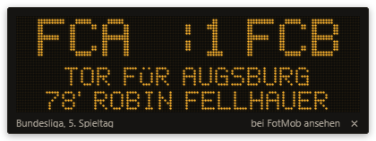
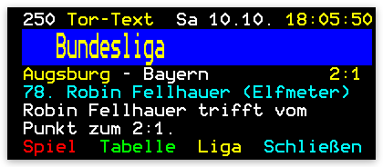
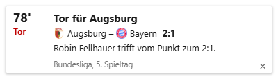
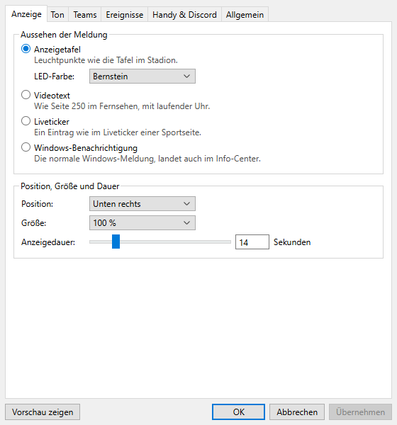

# Tor-Alarm

Ein kleines Windows-Programm, das dir jedes Tor direkt auf den Desktop meldet – Bundesliga, 2. Liga,
3. Liga, Frauen-Bundesliga, DFB-Pokal und Europapokal. Kein Browser-Tab, kein Handy-Gucken: Wenn's
klingelt, steht unten rechts sofort, wer getroffen hat.

**Webseite & Download: https://uwemanfred64-png.github.io/tor-alarm/**



## Was es kann

- **Jedes Tor in Sekunden**, mit Torschütze, Minute, Elfmeter, Eigentor und Vorlage. Nimmt der VAR ein
  Tor zurück, kommt auch das („Kein Tor") – und wenn es dann doch zählt, „Tor zählt doch".
- **Vier Looks zum Aussuchen**: Stadion-Anzeigetafel mit Leuchtpunkten, Videotext wie Seite 250,
  Liveticker-Eintrag oder ganz normal als Windows-Benachrichtigung. Dazu Ecke, Größe und Anzeigedauer.
- **Lieblingsverein**: Tore deines Vereins kommen mit großem „TOOOR!" und eigenem Sound.
  Gegentore wahlweise normal, leise oder gar nicht.
- **Mehr als Tore, wenn du willst**: Anpfiff, Halbzeit, Abpfiff und Rote Karten – jeweils einzeln an/aus,
  mit passendem Pfiff (einer zum Anpfiff, zwei zur Pause, drei zum Schluss).
- **Alle Spielstände auf Knopfdruck**: Strg+Alt+T zeigt die Konferenz aller laufenden Spiele.
- **Aufs Handy oder in Discord**: Tore auf Wunsch zusätzlich als Push aufs Handy (über die kostenlose
  App ntfy, ohne Konto) oder in einen Discord-Kanal deiner Wahl.
- **Im Discord-Profil**: Freunde sehen „Schaut Tor-Alarm" mit dem laufenden Spielstand, dem Logo der
  Liga und einem Knopf zum Herunterladen (lässt sich abschalten).
- **Ton nach Geschmack**: Schiri-Pfiff, Stadionhupe, Torglocke, Jubel – oder deine eigene Torhymne als
  MP3. Stumm schalten für eine Stunde oder feste Ruhezeiten gehen auch.
- Nach Standby oder Funkloch gibt es keine Pfiff-Lawine, sondern pro Spiel eine kurze Zusammenfassung,
  was du verpasst hast.

| Videotext | Liveticker |
| --- | --- |
|  |  |

## Installieren

1. Rechts unter **Releases** die Datei `Tor-Alarm-Setup-1.1.0.exe` herunterladen.
2. Ausführen und durchklicken.
   Weil das Programm nicht kostenpflichtig signiert ist, zeigt Windows eventuell
   „Der Computer wurde durch Windows geschützt" – dann auf **Weitere Informationen → Trotzdem ausführen**.
3. Tor-Alarm sitzt danach unten rechts im Infobereich der Taskleiste (kleine Anzeigetafel mit „1:0",
   eventuell hinter dem Pfeil ^). Rechtsklick öffnet das Menü, Doppelklick die Einstellungen.

Startet von selbst mit Windows (lässt sich in den Einstellungen abschalten). Deinstallieren ganz normal
über *Einstellungen → Apps*.



## Tore aufs Handy (ntfy)

1. Die kostenlose App **ntfy** installieren (Android/iOS).
2. In der App ein Thema abonnieren, z. B. `tor-alarm-deinname-1234` (möglichst ausgefallen – jeder, der
   den Namen kennt, kann mitlesen).
3. Dasselbe Thema in Tor-Alarm unter *Einstellungen → Handy & Discord* eintragen und „Test senden".

Für Discord: im Kanal *Einstellungen → Integrationen → Webhooks → Neuer Webhook*, die Adresse kopieren
und in Tor-Alarm einfügen.

## Woher kommen die Daten?

Die Spielstände kommen von FotMob (die öffentlichen Daten, die auch die FotMob-Webseite benutzt); fällt
FotMob aus, springt OpenLigaDB ein (Bundesliga, 2. und 3. Liga). Tor-Alarm ist ein inoffizielles
Fan-Projekt und hat nichts mit der DFL, dem DFB, der UEFA, FotMob oder den Vereinen zu tun. Ändert FotMob
seine Daten, kann es sein, dass Tor-Alarm ein Update braucht.

## Selbst bauen

Voraussetzung: Node.js 20 oder neuer.

```
npm install
npm start          # App starten
npm test           # Tests
npm run dist       # Setup-Datei bauen (landet in dist/)
```

## Lizenz

MIT – siehe [LICENSE](LICENSE).
